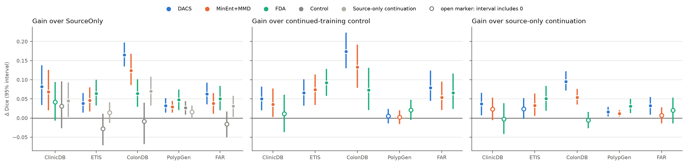
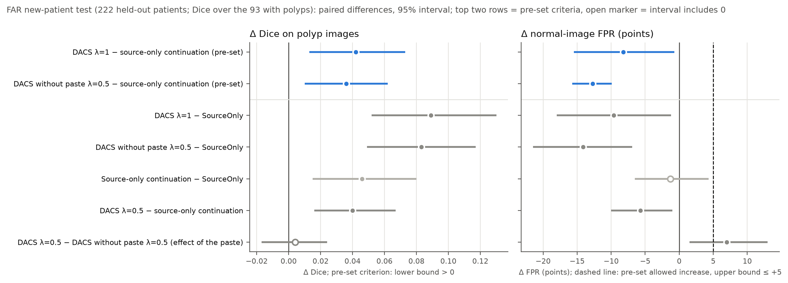

# Unsupervised Domain Adaptation for Polyp Segmentation with a Fixed U-Net

Can a plain U-Net trained on one hospital's colonoscopy images be adapted to new hospitals, devices and patients, using only their **unlabelled** images, so that it segments polyps better than if it were simply trained longer? And does adaptation raise false positives on normal images?

This repository holds the code, pre-registered protocol and results of a benchmark that answers this:

- the **U-Net is fixed** (Ronneberger et al.; base width 16, depth 4, 256×256 input);
- 11 adaptation methods are compared on 5 target domains;
- every deployed model is paired with two references: a matched continued-training control, and a source-only continuation that never sees target data;
- the main claims are checked by two tests frozen before any run.

## Key results

Deployed Dice on polyp images; mean of 6 source runs. Normal-image false-positive rate in brackets.

| Method | ClinicDB | ETIS | ColonDB | PolypGen | FAR | PolypDB Hanoi (holdout) |
|---|---:|---:|---:|---:|---:|---:|
| DACS | 0.686 | 0.403 | 0.609 | 0.617 (37%) | 0.565 (45%) | 0.788 |
| DACS without paste (λ=0.5) | 0.700 | 0.431 | 0.580 | 0.624 (16%) | 0.570 (36%) | 0.790 |
| MinEnt+MMD | 0.670 | 0.412 | 0.568 | 0.615 (40%) | 0.542 (65%) | – |
| FDA | 0.650 | 0.430 | 0.508 | 0.629 (37%) | 0.563 (54%) | – |
| Source-only continuation | 0.654 | 0.379 | 0.514 | 0.601 (27%) | 0.533 (54%) | 0.774 |
| Continued-training control | 0.637 | 0.338 | 0.435 | 0.615 (79%) | 0.492 (74%) | – |
| SourceOnly | 0.610 | 0.366 | 0.444 | 0.582 (25%) | 0.510 (57%) | 0.751 |

- **Adaptation helps.**
  - DACS beats SourceOnly on all five targets (+0.032 to +0.165 Dice).
  - It beats the target-free source-only continuation on four of them.
- **Confirmed on unseen data.** Both tests were frozen in a commit before any run and evaluated once:
  - **New hospital** (PolypDB Hanoi): DACS λ=1 over SourceOnly, +0.035 [+0.023, +0.049].
  - **New patients** (FAR, 222 patients never used for adaptation), against source-only continuation:
    - DACS λ=1: Dice +0.042 [+0.013, +0.073], false positives −8.2 [−15.5, −0.7] points;
    - DACS without paste: Dice +0.036 [+0.010, +0.062], false positives −12.7 [−15.7, −9.9] points.
- **What works.** Teacher pseudo-label self-training is the active part of DACS. The cross-domain paste helps only on ColonDB and adds 7–9 points of false positives.
- **Caveats.**
  - Letting target images into BatchNorm, with no target loss, hurts by itself: up to +51 points of false positives. The usual "continued training" control therefore overstates gains.
  - On PolypGen every method raises false positives over SourceOnly.
  - Choosing a checkpoint within one method is reliable; choosing among methods without labels is not.

Paired 95% intervals bootstrap jointly over source runs and patient/video/centre groups. See [REPORT_BASIS.md](REPORT_BASIS.md) for every number, its source table and the limitations.





## Repository structure

```
├── train.py, select_model.py, utils.py   source U-Net training and source-validation selection
├── models/unet.py                        the fixed U-Net
├── datasets/                             dataset file helpers and readers
├── scripts/                              data preparation, source-run matrix, environment setup
├── benchmark/                            adaptation methods, scoring, validators, analysis, tables, figures
│   ├── uda.py                            11 UDA methods, control, source-only continuation, DACS ablations
│   ├── validators.py                     19 label-free validators
│   ├── splits/                           PolypGen normal hold-out, FAR patient groups and patient split
│   └── ...                               one module per analysis (see Usage)
├── protocol.yaml                         source-model protocol and data split hashes
├── benchmark_protocol.yaml               pre-registered benchmark rules, including amendment v2
├── results/
│   ├── benchmark/                        result tables (*.md, candidates.csv) and figures/
│   ├── manifests/                        data manifests with SHA-256, deployed models, environment
│   └── per_image/                        per-image results of every deployed model
└── REPORT_BASIS.md                       full results, discussion and references for the report
```

Datasets, checkpoints and score caches are not in the repository. They live in the git-ignored `data/` and `runs/`.

## Installation

Tested on Windows 11, Python 3.11, PyTorch 2.11 with CUDA 12.8 on an RTX 5070. The full environment is in [results/manifests/environment.txt](results/manifests/environment.txt).

```powershell
.\scripts\setup_windows.ps1
```

Or manually: install PyTorch for your CUDA version from [pytorch.org](https://pytorch.org/get-started/locally/), then:

```bash
pip install -r requirements.txt
```

## Data

Download the archives below into `data/`. Their sizes and SHA-256 hashes are in [results/manifests/archives.csv](results/manifests/archives.csv). Every image used per scenario (path, group, role, SHA-256) is listed in `results/manifests/<scenario>.csv`.

| Dataset | Role | Source | Archive |
|---|---|---|---|
| Kvasir-SEG | source | [Simula](https://datasets.simula.no/kvasir-seg/) | `kvasir-seg.zip` |
| CVC-ClinicDB | target (inductive split) | [CVC](https://pages.cvc.uab.es/CVC-Colon/index.php/databases/) | `CVC/CVC-ClinicDB_datasets.zip` |
| CVC-ColonDB, ETIS-LaribPolypDB | targets | PraNet test set ([PraNet](https://github.com/DengPingFan/PraNet)) | `TestDataset.zip` |
| PolypGen (C1–C6 + negative sequences) | target | Ali et al., [Scientific Data 2023](https://www.nature.com/articles/s41597-023-01981-y) | `PolypGen2021_MultiCenterData_v3.zip` |
| FAR-POLYP-SEG | target, new-patient test | [Zenodo](https://doi.org/10.5281/zenodo.20284781) | `FAR-POLYP-SEG/Dataset.zip` |
| PolypDB (Hanoi centre, white light only) | frozen holdout | [OSF](https://osf.io/pr7ms/), no licence stated, research use only | `PolypDB/PolypDB.zip` |

Splits:
- **Source and ClinicDB:** generated by `scripts/prepare_polyp_data.py` and locked by SHA-256 in `protocol.yaml`.
- **PolypGen and FAR:** the normal-image hold-out and patient groups are in [benchmark/splits/](benchmark/splits/).

## Usage

Build the scenario caches, train the six source runs and register them:

```bash
python -m benchmark.data
```

```bash
python -m scripts.run_matrix
```

```bash
python -m benchmark.score register-source
```

Run one target end to end (control, adaptation methods, scoring, analysis). `LAMS` and `EVERY` set λ values and checkpoint spacing:

```bash
bash benchmark/run_scenario.sh etis dacs minent_mmd fda
```

```bash
python -m benchmark.report --scenario etis
```

| Command | Purpose |
|---|---|
| `python -m benchmark.uda grid --scenario <s> --algorithms <m...>` | Adapt every source run with the given methods and λ values |
| `python -m benchmark.uda train --algorithm continue --scenario <s> --lams 0` | Matched continued-training control |
| `python -m benchmark.uda train --algorithm continue_source --scenario all --lams 0` | Source-only continuation (no target data) |
| `python -m benchmark.uda train --algorithm dacs_nopaste\|dacs_noweight --scenario <s> --lams 0.5` | DACS ablations |
| `python -m benchmark.score run --pool <pool> --scenarios source_val <s>` | Native-resolution metrics and validator scores |
| `python -m benchmark.analyze --pools <pools...> --name <name>` | Oracle, selection loss, label budget |
| `python -m benchmark.report --scenario <s>` | Paired-gain table for one target |
| `python -m benchmark.compare` | H2, endpoints, deployment rule, controls, ablations |
| `python -m benchmark.selection` | Checkpoint selection (needs `analyze` runs `v2_source_only`, `v2_all`, `v2_full`) |
| `python -m benchmark.postprocess` | Small-component post-processing of deployed models |
| `python -m benchmark.curves` | λ and training-length curves, small-polyp Dice |
| `python -m benchmark.holdout` | Frozen PolypDB Hanoi test (evaluated once) |
| `python -m benchmark.newpatients` | Frozen FAR new-patient test (evaluated once) |
| `python -m benchmark.summary_figures` | Summary figures from the tables in git |
| `python -m benchmark.qualitative` | Rule-chosen qualitative examples |
| `python -m benchmark.extra --pool <pool>` | Optional feature-based and second-round validators |

## Reproducing the results

The commands for every run, including the phase-2 controls, the ablations, the holdout and the new-patient test, are recorded with their pre-registered settings in [benchmark_protocol.yaml](benchmark_protocol.yaml) (`amendment_v2`). The full GPU sequence:

```bash
bash benchmark/run_scenario.sh clinicdb minent advent dann mmd bnm mcc meanteacher fda minent_mmd dacs
```

```bash
bash benchmark/run_scenario.sh etis minent mmd dann fda minent_mmd dacs
```

```bash
bash benchmark/run_scenario.sh colondb minent mmd dann fda minent_mmd dacs
```

```bash
EVERY=400 bash benchmark/run_scenario.sh polypgen fda minent_mmd dacs
```

```bash
LAMS=0.5 EVERY=400 bash benchmark/run_scenario.sh far fda minent_mmd dacs
```

**Without a GPU.** The checkpoints deployed by every trajectory, with their SHA-256, are in [results/manifests/deployed_models.csv](results/manifests/deployed_models.csv). Their per-image scores are in `results/per_image/`. This recomputes ClinicDB's paired DACS gain (+0.082) from tracked files only:

```bash
python -m benchmark.manifest verify
```

A complete rerun on a new machine has not been done. The checks so far:
- the split files read from `benchmark/splits/` match the originals line by line;
- `verify` reproduces the published gain.

## Methods compared

| Group | Methods |
|---|---|
| References | SourceOnly; continued-training control (joint forward, λ=0); source-only continuation (no target forward) |
| Normalisation | AdaBN |
| Output level | MinEnt, AdvEnt, pixel BNM, pixel MCC |
| Feature level | DANN, multi-kernel MMD |
| Input level | FDA |
| Teacher | Mean Teacher |
| Segmentation-specific | MinEnt+MMD; DACS (cross-domain paste + EMA-teacher pseudo-labels); DACS without paste; DACS without confidence weight |

Each deployed model is the checkpoint with the best source-validation Dice within its training run. This rule was fixed in advance; target labels are used only for evaluation.

## Citation

If you use this code or the results, please cite the datasets and methods listed in [REPORT_BASIS.md](REPORT_BASIS.md#references). The datasets keep their own licences; no medical images are distributed in this repository.
