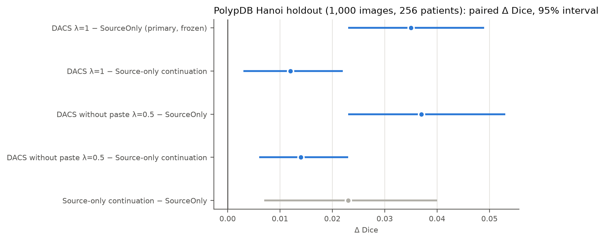

# 域偏移下的息肉分割：固定 U-Net 的无监督域适应

源域 Kvasir-SEG 有标签，目标医院/设备（CVC-ClinicDB、ETIS、CVC-ColonDB、PolypGen、FAR）只有无标签图片。本项目研究：无监督域适应能否让**原始 U-Net**（基础通道 16、4 层、输入 256，结构固定）在新域上稳定地比“继续训练”分割得更好，以及适应后的模型能否不用目标标签选出来。

每个方法都与同起点、同步数、无目标损失的**继续训练对照**以及完全不用目标数据的**纯源域继续训练**配对比较，部署的检查点按源验证 Dice 事前固定的规则选择，目标标签只用于最终评价。

## 当前结果（2026-11-13，协议修正 v2）

部署 Dice（阳性图，每条轨迹按源验证选检查点，6 条源轨迹的均值；括号内为正常图误报）：

| 方法 | ClinicDB | ETIS | ColonDB | PolypGen | FAR | PolypDB 河内（留出） |
|---|---:|---:|---:|---:|---:|---:|
| DACS | 0.686 | 0.403 | 0.609 | 0.617（37%） | 0.565（45%） | 0.788 ¹ |
| DACS 去掉粘贴（λ=0.5） | 0.700 | 0.431 | 0.580 | 0.624（16%） | 0.570（36%） | 0.790 |
| MinEnt+MMD | 0.670 | 0.412 | 0.568 | 0.615（40%） | 0.542（65%） | – |
| FDA | 0.650 | 0.430 | 0.508 | 0.629（37%） | 0.563（54%） | – |
| MinEnt | 0.664 | 0.393 | 0.534 | – | – | – |
| MMD | 0.658 | 0.388 | 0.541 | – | – | – |
| 纯源域继续训练（不用目标数据） | 0.654 | 0.379 | 0.514 | 0.601（27%） | 0.533（54%） | 0.774 |
| 继续训练对照（目标图进入 BatchNorm） | 0.637 | 0.338 | 0.435 | 0.615（79%） | 0.492（74%） | – |
| SourceOnly | 0.610 | 0.366 | 0.444 | 0.582（25%） | 0.510（57%） | 0.751 |

方法行对 λ 0.1 / 0.5 / 1 取平均（FAR 只有 λ=0.5）；“DACS 去掉粘贴”只有 λ=0.5，不能与平均值直接比大小。¹ 留出集上是事前冻结的部署规则 DACS λ=1。PolypGen 只算掩码非空的 1,412 张图（v2 修正，见 [metric_correction.md](results/benchmark/metric_correction.md)）。

- **相对 SourceOnly：** DACS、MinEnt+MMD 在 5/5 个目标上区间不含零，FDA 4/5。
- **对照偏弱：** 继续训练对照里，目标图只进入 BatchNorm 本身有害（ColonDB、FAR 上 Dice 下降；正常图误报 PolypGen +51、FAR +19 个百分点）。相对不用目标数据的纯源域继续训练，DACS 仍在 4/5 个目标上显著更好，MinEnt+MMD 3/5，FDA 2/5。
- **组合方法：** 与事前指定的单一方法直接比较，DACS、MinEnt+MMD 只在 ColonDB 上全部胜出；“组合更好”只有均值支持。
- **DACS 消融：** 跨域粘贴只在 ColonDB 上提高 Dice（+0.044），其余 4 个目标上没有帮助，并在 PolypGen、FAR 上增加正常图误报 8–9 个百分点；主要起作用的是 EMA 教师的硬伪标签自训练。
- **正常图误报：** 同时提高 Dice 并降低误报的只有 DACS 在 FAR 上；PolypGen 上三种方法的误报都比 SourceOnly 高 11–15 个百分点。小连通域后处理（事前固定）不改变 Dice，误报 FAR 降 5–7、PolypGen 降 4–5 个百分点。
- **独立确认：** 事前冻结的规则在从未使用的 PolypDB 河内中心（1,000 张，256 名患者，新医院、新内镜）上通过：相对 SourceOnly +0.035 [+0.023, +0.049]，6/6；相对纯源域继续训练 +0.012 [+0.003, +0.022]。原计划的 CVC-300 是 CVC-ColonDB 的子集，已取消。
- **无标签选模：** 方法固定时，按源验证在轨迹内选检查点损失小（0.003–0.032）；跨方法全局选模常选中对照检查点，不可靠。

### 图

| 图 | 内容 |
|---|---|
| [gains.png](results/benchmark/figures/gains.png) | 各方法在五个目标上相对 SourceOnly、继续训练对照、纯源域继续训练的配对收益与 95% 区间 |
| [controls.png](results/benchmark/figures/controls.png) | 对照拆解：目标图进入 BatchNorm 的影响与多训练源域的影响（Dice、正常图误报） |
| [ablation.png](results/benchmark/figures/ablation.png) | DACS 去掉跨域粘贴的消融（Dice、小息肉 Dice、正常图误报） |
| [holdout.png](results/benchmark/figures/holdout.png) | PolypDB 河内留出集上的事前冻结检验 |
| [dice_fpr.png](results/benchmark/figures/dice_fpr.png) | PolypGen、FAR 上部署 Dice 与正常图误报 |
| [lambda.png](results/benchmark/figures/lambda.png)、[step_curves.png](results/benchmark/figures/step_curves.png)、[step_fpr.png](results/benchmark/figures/step_fpr.png) | λ 敏感性与训练步数曲线 |
| `qualitative_<目标>.png` | 按固定规则选图的定性例子（[选图清单](results/benchmark/qualitative.md)） |




完整设计、结果与局限见[项目总览与实验设计](项目总览与实验设计.md)。

## 文档

| 文件 | 内容 |
|---|---|
| [项目总览与实验设计.md](项目总览与实验设计.md) | 研究问题、数据、方法、评价、全部结果、剩余工作、局限、参考文献（报告格式） |
| [EXPERIMENT_PROPOSAL.md](EXPERIMENT_PROPOSAL.md) | 英文实验方案：假设、已完成、待做与判定规则 |
| [benchmark_protocol.yaml](benchmark_protocol.yaml) | 事前固定的场景、方法、部署规则、指标与验证器设置 |
| [results/benchmark/](results/benchmark/) | 各目标的逐候选分数（`candidates.csv`）、配对收益表（`paired.md`）、`h2.md`、`endpoints.md`、`selection.md`、`deployment.md`、`controls.md`、`ablations.md`、`holdout_polypdb.md`、`metric_correction.md`、后处理与曲线表、`figures/` 中的全部图 |
| [results/manifests/](results/manifests/)、[results/per_image/](results/per_image/) | 数据清单与哈希、部署模型清单、运行环境；部署模型的逐图结果 |
| [每日进度.md](每日进度.md) | 每天的完成情况和下一步 |
| [失败方法记录.md](失败方法记录.md) | 2026-10-31 之前 18 类未达目标的尝试（报告附录） |

## 代码

| 入口 | 用途 |
|---|---|
| `train.py`、`select_model.py` | 源域 U-Net 训练（A0/A1 × 种子 42/43/44）与源验证选模 |
| `python -m benchmark.data` | 构建各场景的 256 图像缓存与原尺寸掩码 |
| `python -m benchmark.uda grid --scenario <场景> --algorithms <方法...>` | AdaBN + 适应方法 × λ × 6 条源轨迹；`--lams`、`--every` 控制 λ 与检查点间隔 |
| `python -m benchmark.uda train --algorithm continue --scenario <场景> --lams 0` | 继续训练对照 |
| `python -m benchmark.uda train --algorithm continue_source --scenario all --lams 0` | 纯源域继续训练（不前向目标图，训练一次、在所有目标上打分） |
| `python -m benchmark.uda train --algorithm dacs_nopaste\|dacs_noweight --scenario <场景> --lams 0.5` | DACS 消融 |
| `python -m benchmark.score run --pool <池> --scenarios source_val <场景>` | 原尺寸指标与验证器打分 |
| `python -m benchmark.analyze --pools <池...> --name <名>` | Oracle、选模差距与区间、标注预算 |
| `python -m benchmark.report --scenario <场景>` | 写入 `results/benchmark/<场景>/` 的配对收益表 |
| `python -m benchmark.postprocess` | 部署模型的小连通域后处理（`results/benchmark/postprocessing.md`） |
| `python -m benchmark.curves` | λ、训练步数曲线与小息肉 Dice（只读 `candidates.csv`，写 `results/benchmark/curves.md` 与 `figures/`） |
| `python -m benchmark.summary_figures` | 汇总图：`gains`、`controls`、`ablation`、`holdout`、`dice_fpr`（`results/benchmark/figures/`） |
| `python -m benchmark.compare` | 协议 v2：H2 直接比较、完整终点、事后部署规则、纯源域继续训练对照与 DACS 消融（`h2.md`、`endpoints.md`、`deployment.md`、`controls.md`、`ablations.md`） |
| `python -m benchmark.selection` | 协议 v2：统一选模表（先运行 `benchmark.analyze` 的 `v2_source_only` 与 `v2_all`） |
| `python -m benchmark.holdout` | 第 3 阶段：PolypDB 河内留出集的一次性评价（`holdout_polypdb.md`；数据需放在 `data/PolypDB/`） |
| `python -m benchmark.qualitative` | 按固定规则选图的定性例子（`results/benchmark/figures/qualitative_<场景>.png`） |
| `bash benchmark/run_scenario.sh <场景> <方法...>` | 一个场景的对照、适应、打分与分析全流程（环境变量 `LAMS`、`EVERY` 可选） |
| `python -m benchmark.extra --pool <池>` | 可选：瓶颈特征、CMR-TTD、MixVal 等第二轮验证器 |

方法实现集中在 [benchmark/uda.py](benchmark/uda.py)（AdaBN、MinEnt、AdvEnt、DANN、MMD、BNM、MCC、Mean Teacher、FDA、MinEnt+MMD、DACS、继续训练对照），验证器在 [benchmark/validators.py](benchmark/validators.py)。源模型训练与数据准备在根目录和 `scripts/`：`prepare_polyp_data.py` 划分 Kvasir/ClinicDB，`run_matrix.py` 按 `protocol.yaml` 训练 6 条源轨迹，`check_protocol.py` 校验划分。

## 复现说明

以下是重建结果所需的数据、划分和命令。尚未在新机器上从头完整重跑验证。目前做过的核对有两项：划分文件改为从 `benchmark/splits/` 读取后与原先逐行一致；`benchmark.manifest verify` 只用 Git 中的文件重算出 ClinicDB 上 DACS 相对 SourceOnly 的收益 +0.082，与 `paired.md` 相同。

**数据（不在仓库中，放在 `data/` 下）。** 原始压缩包的大小和 SHA-256 见 [results/manifests/archives.csv](results/manifests/archives.csv)；每个场景用到的每张图片（相对 `data/` 的路径、组、角色、SHA-256）见 `results/manifests/<场景>.csv`。

| 数据 | 来源 | 本地压缩包 |
|---|---|---|
| Kvasir-SEG（源域） | [Simula](https://datasets.simula.no/kvasir-seg/) | `kvasir-seg.zip` |
| CVC-ClinicDB | [CVC](https://pages.cvc.uab.es/CVC-Colon/index.php/databases/) | `CVC/CVC-ClinicDB_datasets.zip` |
| CVC-ColonDB、ETIS-LaribPolypDB | PraNet 测试集（[PraNet](https://github.com/DengPingFan/PraNet)） | `TestDataset.zip` |
| PolypGen（C1–C6 单帧 + 阴性序列） | Ali 等，[Scientific Data 2023](https://www.nature.com/articles/s41597-023-01981-y) | `PolypGen2021_MultiCenterData_v3.zip` |
| FAR-POLYP-SEG | [Zenodo](https://doi.org/10.5281/zenodo.20284781) | `FAR-POLYP-SEG/Dataset.zip` |
| PolypDB（只用河内中心白光图，留出集） | [OSF](https://osf.io/pr7ms/)，数据集未注明许可，仅作研究使用 | `PolypDB/PolypDB.zip` |

**划分。** 源域与 ClinicDB 的划分由 `scripts/prepare_polyp_data.py` 生成并由 `protocol.yaml` 中的 SHA-256 锁定，具体文件见 `results/manifests/source_train.csv`、`source_val.csv`、`clinicdb.csv`。PolypGen 正常图留出集和 FAR 患者分组在 [benchmark/splits/](benchmark/splits/)，`benchmark/data.py` 直接读取，不再依赖 `runs/`。

**从头运行（GPU）。** 先按下方“环境”一节建好环境，然后依次运行：

```bash
.venv/Scripts/python.exe -m scripts.run_matrix
```

```bash
.venv/Scripts/python.exe -m benchmark.score register-source
```

```bash
bash benchmark/run_scenario.sh clinicdb minent advent dann mmd bnm mcc meanteacher fda minent_mmd dacs
```

```bash
bash benchmark/run_scenario.sh etis minent mmd dann fda minent_mmd dacs
```

```bash
LAMS=0.5 EVERY=400 bash benchmark/run_scenario.sh far fda minent_mmd dacs
```

ColonDB 与 ETIS 相同；PolypGen 用 `EVERY=400`、三个 λ。第 2 阶段对照与消融、第 3 阶段留出集的命令见 [benchmark_protocol.yaml](benchmark_protocol.yaml) 的 `amendment_v2` 和上面的代码表。

**汇总表与图（CPU）。** `benchmark.report`（每个目标）、`benchmark.compare`、`benchmark.selection`、`benchmark.postprocess`、`benchmark.curves`、`benchmark.summary_figures`、`benchmark.holdout`。

**不用 GPU 复核。** [results/manifests/deployed_models.csv](results/manifests/deployed_models.csv) 列出每条轨迹部署的检查点及其 SHA-256；`results/per_image/<目标>.csv.gz` 是这些模型的逐图 Dice 与原尺寸前景比例。

```bash
.venv/Scripts/python.exe -m benchmark.manifest verify
```

它只用 Git 中的文件重算 ClinicDB 上 DACS 相对 SourceOnly 的配对收益。运行环境（Python、PyTorch、CUDA、GPU、`pip freeze`）记录在 [results/manifests/environment.txt](results/manifests/environment.txt)。

## 环境

训练和评价在 Windows + CUDA 上运行（RTX 5070）。仓库不包含数据集、权重或缓存；检查点和逐图分数在被 Git 忽略的 `runs/`，写报告需要的汇总表和图在 `results/benchmark/`。

新 Windows 环境：

```powershell
.\scripts\setup_windows.ps1
```

示例：在 ETIS 上跑三个方法的完整流程并生成报告：

```bash
bash benchmark/run_scenario.sh etis dacs minent_mmd fda
.venv/Scripts/python.exe -m benchmark.report --scenario etis
```
